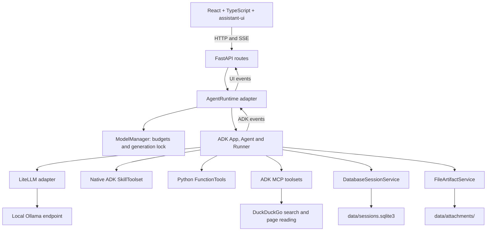

# LocalChat

A local chat application built with a Python FastAPI backend, Google ADK agents,
Ollama inference, and a React + assistant-ui frontend. Chat history and uploaded
images stay under `data/`. Web research uses the public internet; chat inference
does not require cloud model credentials.

## Setup

Run commands from the project root unless a command explicitly changes directory.
Clone or download this repository first, then open a terminal in its root folder.
The shell examples below use POSIX syntax; `uv run` commands also avoid needing
to activate the virtual environment or locate its Python executable manually.

Requirements:

- Ollama installed and running.
- uv for the Python environment.
- Node.js **24.19.0** (the recorded development version; minimum **22.12**)
  and pnpm **11.25.0** for building the UI.
- Python **3.14.8**, installed by uv below.

Python and Node versions are recorded in `.python-version` and
`frontend/.node-version`. `uv.lock` and `frontend/pnpm-lock.yaml` pin dependencies;
keep both lockfiles when sharing the project.

### 1. Install the chat model

```sh
ollama pull gemma4:e2b
ollama list
```

Start the Ollama application, or run `ollama serve` if it is not already running.
Other installed chat models can be selected in the UI. Image uploads require a
vision model; tool use requires a model that supports tools.

### 2. Create the Python environment

```sh
uv python install 3.14.8
uv sync --locked
```

This creates `.venv/` and installs the backend, ADK, LiteLLM, the DuckDuckGo MCP
server, and development dependencies. No separate search-server installation is
needed. ADK and LiteLLM are pinned to 2.12.0 and 1.105.1 respectively.

### 3. Build the frontend

```sh
cd frontend
pnpm install --frozen-lockfile
pnpm build
cd ..
```

### 4. Start the app

```sh
uv run --locked uvicorn localchat.main:app --host 127.0.0.1 --port 8000
```

Open [LocalChat](http://127.0.0.1:8000/) or the
[interactive API documentation](http://127.0.0.1:8000/docs).
FastAPI serves the compiled UI, so a separate Node server is not needed.
Use **one Uvicorn worker**: model scheduling and conversation locks are in process.
The default address is accessible from the host computer only.
The frontend build is required after a fresh clone: `node_modules/` and `dist/`
are generated locally and are not committed.

For backend development, add `--reload` to the startup command. For frontend
hot reload, keep FastAPI running and, in another
terminal, run `cd frontend` followed by `pnpm dev`. Open the URL printed by Vite;
its API proxy targets port 8000. When using the FastAPI-served UI instead, rebuild
the frontend and reload the browser after frontend edits.

### 5. Use and stop the app

Choose an installed chat model, type a message, and send it. A conversation is
created automatically on the first send. Enable **Web research** when you want
the agent to use the bundled search skill. For vision chat, select a vision model
and attach an image before sending your question.

Press **Ctrl+C** in the app terminal to stop FastAPI and its MCP server. Ollama
is a separate service: if you launched it with `ollama serve`, press **Ctrl+C**
in that terminal too. If you launched Ollama as a desktop application, quit it
there. Stopping the servers does not delete conversations or model downloads.

### Common setup issues

| Symptom | What to check |
| --- | --- |
| UI says to build the frontend | Run `pnpm install --frozen-lockfile` and `pnpm build` from `frontend/`, then reload the page |
| Ollama offline or model not installed | Start Ollama, run `ollama list`, and pull the configured model or set `LOCALCHAT_MODEL` to one you have |
| Startup fails connecting to search | Check internet access and `mcp.toml`; use `servers = []` to start without MCP tools |
| Responses are slow or memory is exhausted | Try a smaller model or lower `LOCALCHAT_CONTEXT_TOKENS`; 128k is a requested allocation, not a hardware recommendation |
| Port 8000 is already in use | Stop the other server or choose another `--port`; update the Vite proxy if using its development server |
| Editing `.env` has no effect | Export its values before starting the app, as shown under Configuration |

RAG, document ingestion, long-term cross-conversation memory, and image/video
generation are future work. No image-generation server or model is required.

## Current capabilities

| Capability | Behavior |
| --- | --- |
| Local chat | Ollama chat models through ADK and LiteLLM, with streamed Markdown responses |
| Conversations | Create, list, reopen, automatically title, and delete saved conversations |
| Conversation history | ADK persists events in SQLite and supplies history to subsequent turns |
| Compaction | ADK summarizes eligible older history at a configurable token threshold |
| Model switching | Choose installed models; selection takes effect on the next send |
| Vision chat | Upload and preview images, then ask questions using a vision model |
| Web research | DuckDuckGo MCP search and page reading, with a native research skill |
| Skills | Names and descriptions are exposed for model selection; instructions load when needed |
| Explicit skills | The Web research toggle requests and activates `web-research` before inference |
| Tool activity | Live per-call progress and returned/stopped state; activity survives reopening chats |
| Cancellation | Stop generation or uploads; reload committed history after a turn |
| Responsive UI | Desktop sidebar; mobile drawer, stacked suggestions, touch controls, and image previews |
| Extension points | Discover trusted Python tools, native ADK skills, and multiple stdio MCP servers at startup |

The UI shows operational status and tool activity, not private model reasoning.
A tool returning does not necessarily mean it succeeded. Search can fail or be
rate-limited, and model adherence to skill instructions depends on the model.

## Architecture



### Code map

```text
localchat/
  main.py                 FastAPI lifecycle, MCP startup/shutdown, static UI
  config.py               Environment settings and validation
  api/routes.py           HTTP contracts, request validation, SSE adapter
  agent/runtime.py        ADK assembly, skill activation, event translation
  models/ollama.py        Installed-model list and metadata requests
  models/manager.py       Model selection, budget caps, serialized model use
  registry/catalog.py     Python tool and native skill discovery
  registry/mcp.py         MCP configuration, connections, name validation
  storage/conversations.py  ADK session-to-conversation views
  storage/attachments.py  Image validation, ADK artifacts, image hydration
  capabilities/           Trusted tools, skills, and extension conventions
frontend/src/
  App.tsx                 Sidebar, model selection, responsive navigation
  components/             Chat workspace, attachments, tool activity
  runtime/                assistant-ui adapter and conversation state
  api/                    HTTP helpers, types, streaming parser
  styles.css              Shared desktop and mobile styling
mcp.toml                  Local MCP server configuration
tests/                   Backend tests (temporary storage and fake models)
```

ADK owns durable session state, tool events, skill activation, and compaction.
The application provides HTTP contracts, UI views, image handling, and model
resource coordination. There is no second messages database or custom agent loop.
The frontend reconciles its live display with saved ADK events after each turn.

### Storage

`data/` is created automatically and ignored by version control:

```text
data/
  sessions.sqlite3        ADK sessions, state, events, and summaries
  attachments/            Conversation-scoped uploaded image artifacts
```

Keep future raw documents, vector indexes, and generated media under this same
root. Those capabilities are not implemented yet. `storage/` contains application
code; `data/` contains runtime files. Back up the data root if you need to preserve
chats. The virtual environment, frontend dependencies, compiled assets, caches,
and local `.env` files are also excluded from version control.

### Model selection and memory

The configured context allocation defaults to **131,072 tokens (128k)**. The
manager caps it at Ollama's reported text-model limit when available. The
compaction trigger is the smaller of **50,000 tokens** and half the effective
context. If context metadata is absent, the configured allocation is used.
Available context depends on hardware resources; model weights, context, images,
and other applications all consume memory.

One shared generation lock protects the agent's model, tools, and compaction
settings throughout each turn, including summarization and cancellation cleanup.
Ollama manages model loading, residency, and unloading. The app creates or reuses
a LiteLLM adapter for the selected model; dropdown changes do not load weights.
Cold loads add latency. Ollama server settings control how many models remain
loaded, including models used by other clients.

A conversation remembers its selected model. Without an explicit request model,
the backend uses that selection, falling back to `LOCALCHAT_MODEL` for a new chat.
Text-only models cannot consume uncompacted image history. Models without tool
support can chat with tools disabled, but cannot accept explicit skill requests.

### Compaction

ADK's `EventsCompactionConfig` and `LlmEventSummarizer` summarize older events
using the selected local model. The latest **eight raw events** are retained;
events are not whole conversation turns, and related tool events may enlarge the
retained range. Original events and summaries remain in SQLite. The UI displays
original messages while future model calls can use summaries and recent history.

Token checks use reported prompt usage where available, with an approximate
history estimate as fallback. Compaction needs eligible older events and may be
skipped. It is not a strict preflight token limit: a large new message or tool
result can still overflow context. Summarization adds latency, may omit facts,
and is experimental in the pinned ADK version. Failures leave raw history usable.
Setting the threshold to `0` disables future compaction; existing summaries remain.

### Image handling

PNG, JPEG, and WebP are accepted, with limits of **10 MiB**, **20 megapixels**, and
**four images per chat request**. Animated images are rejected. The backend
decodes uploads rather than trusting extensions or MIME headers. A text question
is required with images.

ADK artifacts store bytes using generated IDs; session events store references.
Before inference, the runtime resolves references to bytes for LiteLLM/Ollama.
Images in retained history support follow-up questions after a restart. Deleting
a conversation removes its session and artifacts. Compaction retains textual
observations rather than original image content in the model prompt; send the
attachment ID again to inspect a compacted image.

## Configuration

The app reads process environment variables. `.env.example` documents supported
settings; `.env` is **not loaded automatically**. To use a local copy in a POSIX
shell, export it before starting the app:

```sh
cp .env.example .env
# Edit .env as needed, then export its settings:
set -a
. ./.env
set +a
```

| Variable | Default | Purpose |
| --- | --- | --- |
| `OLLAMA_URL` | `http://127.0.0.1:11434` | Ollama endpoint |
| `LOCALCHAT_MODEL` | `gemma4:e2b` | Default chat model |
| `LOCALCHAT_CONTEXT_TOKENS` | `131072` | Requested Ollama `num_ctx`, capped by model metadata |
| `LOCALCHAT_DATA` | `data` | SQLite and artifact root |
| `LOCALCHAT_MCP_CONFIG` | `mcp.toml` | MCP configuration path |
| `LOCALCHAT_COMPACTION_TOKENS` | `50000` | Compaction trigger; `0` disables |
| `LOCALCHAT_COMPACTION_RETENTION` | `8` | Recent raw events to retain |

Relative paths resolve from the working directory. Restart after changing
settings, tools, skills, or MCP configuration. Ollama context settings apply to
this app's requests, including summarization, rather than other Ollama clients.

## Tools, skills, and MCP

See [capability conventions](localchat/capabilities/README.md) for examples.

- **Tools:** add a trusted Python module under `localchat/capabilities/tools/`
  with `build_tools()` returning callables or ADK `FunctionTool` objects.
- **Skills:** add `skills/<skill-name>/SKILL.md` with native ADK YAML frontmatter
  and instructions. Names/descriptions form the initial catalog; `load_skill`
  loads instructions when selected. No separate metadata TOML is needed.
- **MCP:** add entries to `mcp.toml` for additional local stdio servers. The app
  starts them and closes connections at shutdown. Use `servers = []` to disable
  MCP. `{python}` and `{venv_bin}` resolve to the active environment.

The bundled `web-research` skill uses `search` and `fetch_content`. Explicit skill
requests validate required tools and load instructions before inference. Activated
skills may remain active in the session, even after the UI toggle is cleared;
the explicit request flag is per turn. Autonomous skill selection remains model
driven. Required-tool validation is enforced for explicit selections.

Tool names must be unique across Python, skill, and MCP tools. Startup fails for
invalid MCP configuration, duplicate names, or unavailable configured servers.
Only install trusted tools, skills, and server commands. Remote HTTP MCP transport
is a future extension. Search queries and page reads leave the machine.

## API

| Method and path | Purpose |
| --- | --- |
| `GET /health` | API health; not an Ollama readiness check |
| `GET /models` | Installed Ollama models without loading them |
| `GET /models/selected?model=<name>` | Default or specified model metadata and budgets without loading it |
| `GET /capabilities` | Python, skill, and MCP tool metadata and skill catalog |
| `POST /conversations` | Create a session; optional `title` |
| `GET /conversations` | List conversations, newest created first |
| `GET /conversations/{id}` | Metadata and visible messages, images, and tool activity |
| `DELETE /conversations/{id}` | Delete session events and uploaded artifacts |
| `POST /attachments` | Multipart image upload into an existing conversation |
| `GET /conversations/{id}/attachments/{attachment_id}` | Read a conversation-scoped image |
| `POST /chat` | Complete agent answer |
| `POST /chat/stream` | Stream text, status, and tool activity via SSE |

Create a conversation before calling chat directly. The browser handles this
when sending the first message. Example request for either chat endpoint:

```json
{
  "conversation_id": "<returned UUID>",
  "message": "Find the Python release date and cite the official source.",
  "model": "gemma4:e2b",
  "requested_skills": ["web-research"],
  "attachment_ids": []
}
```

Only `conversation_id` and `message` are required. Omit `requested_skills` for
model-selected skills. Unknown skills and unavailable required tools return 422.
Upload an image first to obtain its ID:

```sh
curl http://127.0.0.1:8000/attachments \
  -F 'conversation_id=<your UUID>' \
  -F 'file=@/absolute/path/picture.png'
```

### Streaming and cancellation

SSE frames contain `data: <JSON>` followed by a blank line.

| Event | Meaning |
| --- | --- |
| `started` | Turn began |
| `skill_loaded` | Explicit skill validated and selected |
| `status` | Model preparation, waiting, or generation status |
| `model_selected` | Selected model and effective token budgets |
| `tool_started` / `tool_finished` | Tool call progress, matched by `call_id` |
| `text_delta` | Append `text` to the live response |
| `done` | Successful completion with canonical `reply` |
| `error` | Failure with a safe message |

Use `done.reply` as the final answer: streamed text may contain a pre-tool preamble.
A stream closing without `done` is not success. Internal thought parts are filtered.
ADK persists incrementally, so failed or cancelled turns may leave partial history.
Disconnect closes generation but cannot undo completed tools or committed events.
Turns, uploads, and deletion use per-conversation locks within the single process.

## Verification

```sh
.venv/bin/python -m pytest -q
cd frontend
pnpm test
pnpm build
```

Backend tests use temporary storage, real ADK execution, and fake model responses.
They cover contracts, persistence, conversation isolation, skills, MCP lifecycle,
streaming, cancellation, compaction, image validation, and model switching.
Frontend tests cover fragmented UTF-8/SSE, CRLF frames, truncated streams, and
cancellation. Responsive layouts have also been checked in browser viewports at
320px and 390px phone widths, 667px landscape, and 1280px laptop width; physical
device and virtual-keyboard behavior should still be checked on target devices.

Optional live checks require Ollama; web research also needs internet access:

```sh
LOCALCHAT_LIVE=1 .venv/bin/python -m pytest tests/test_web_mcp.py::test_live_all_endpoints_and_memory -v
LOCALCHAT_WEB_LIVE=1 .venv/bin/python -m pytest tests/test_web_mcp.py::test_live_web_research -v
LOCALCHAT_LIVE=1 .venv/bin/python -m pytest tests/test_compaction.py::test_live_compaction_preserves_reference_word -v
LOCALCHAT_VISION_LIVE=1 .venv/bin/python -m pytest tests/test_attachments.py::test_live_image_understanding -v
```

## Next steps

1. **Exercise the UI on real devices:** verify virtual keyboards, safe areas,
   long conversations, and model errors; add UI integration tests for key flows.
2. **Add document ingestion and RAG:** store raw documents and a vector index in
   `data/`; add PDF reading, retrieval tools, and a research skill with citations.
3. **Add long-term retrieval:** deliberate cross-conversation memory and controls
   for what is saved, searched, and deleted. Current history is session scoped.
4. **Extend resource scheduling:** coordinate chat, embeddings, image, and video
   workers under a shared RAM budget with unload/load and progress states.
5. **Add image and video generation:** expose model backends as tools, skills, or
   subagents; store media under `data/` and add UI components for their results.
6. **Expand discovery as needed:** searchable skill metadata for a larger catalog,
   additional MCP transports, and skill-specific evaluations.

Authentication, multi-user isolation, distributed scheduling, and remote deployment
are not implemented. Address them before exposing this single-user app publicly.
